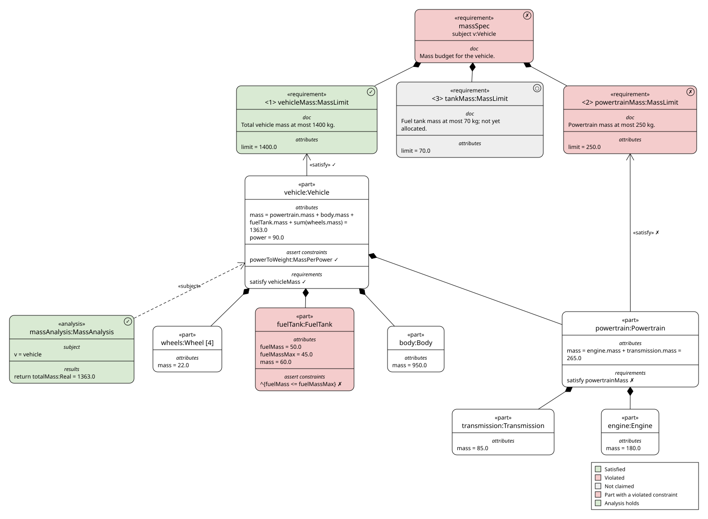
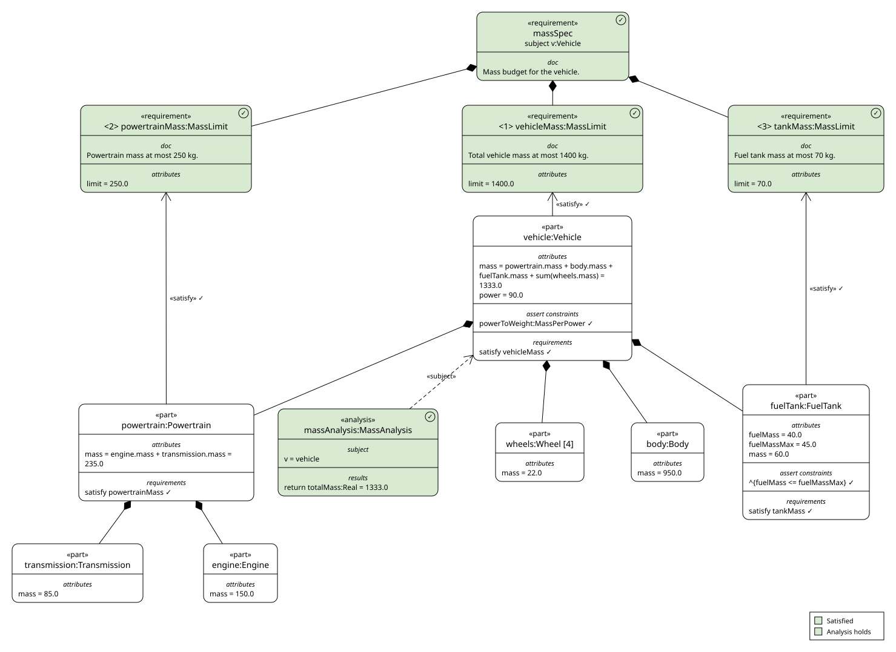

# Mass roll-up demo

A vehicle whose mass rolls up from its parts, with a mass budget it has to
meet and constraints its design must keep. OpenSysML computes the totals,
checks the requirements and checks the asserted constraints. The viewer
shows each requirement green (✓ satisfied), red (✗ violated) or grey (○ not
claimed), the budget as a whole takes the worst of its parts, and each
asserted constraint is marked ✓ or ✗ on the part it applies to.

```
vehicle      = powertrain + body + fuelTank + 4 × wheel
powertrain   = engine + transmission
```

There are two variants of the same Model, each in its own folder:

| Requirement | Limit | [`failing/`](failing) | [`passing/`](passing) |
|---|---|---|---|
| `<1> vehicleMass` | 1400 kg | ✓ 1363 kg | ✓ 1333 kg |
| `<2> powertrainMass` | 250 kg | ✗ 265 kg (engine 180) | ✓ 235 kg (engine 150) |
| `<3> tankMass` | 70 kg | ○ nothing claims it | ✓ 60 kg |
| `massSpec` (all three) | | ✗ | ✓ |

| Asserted constraint | Rule | `failing/` | `passing/` |
|---|---|---|---|
| `FuelTank::fuelFits`, inherited by `vehicle.fuelTank` | fuel ≤ 45 kg | ✗ 50 kg | ✓ 40 kg |
| `vehicle::powerToWeight : MassPerPower` | ≤ 16 kg per kW | ✓ 1363 / 90 ≈ 15.1 | ✓ 1333 / 90 ≈ 14.8 |

### Failing

The powertrain is 15 kg over its budget and nothing claims the tank's
requirement yet, so the budget as a whole is red. The fuel tank is red too:
it carries more fuel than its definition allows (`^` marks the inherited
constraint).



### Passing

A 30 kg lighter engine brings the powertrain under budget, the tank's
requirement is claimed, and the tank carries 40 kg of fuel, so every
requirement, the budget and every constraint are green.



Both pictures are the viewer's own SVG Export of the `mass-overview`
Diagram. A test checks they match the Models; after changing a Model,
refresh them with
`UPDATE_GOLDEN=1 cargo test -p viewer-opensysml --test contract readme_pictures -- --ignored`.

## See it

```sh
# from the repository root
WAYLAND_DISPLAY= cargo run -p viewer-app -- examples/mass-rollup/failing
WAYLAND_DISPLAY= cargo run -p viewer-app -- examples/mass-rollup/passing
```

Open **mass-overview** under Saved Diagrams. It shows the parts tree with each
mass, the requirements with their limits, their `«satisfy»` edges and a
Legend, coloured by the Model Style in `diagrams/style.json`.

## Make it change

With the viewer open on `failing/`, edit its `vehicle.sysml` and save. The
viewer reloads and re-checks.

- **Turn the powertrain green:** set the engine's mass to `150.0`
  (150 + 85 = 235 ≤ 250).
- **Claim the tank requirement:** add
  `satisfy massSpec.tankMass by vehicle.fuelTank;` (60 ≤ 70).
- **Make the tank's fuel fit:** set its `fuelMass` to `40.0` (≤ 45).
- With all three, `failing/` becomes `passing/`: `massSpec` and the tank turn
  green.
- **Turn the vehicle red:** set the body's mass to `1000.0`
  (265 + 1000 + 60 + 88 = 1413 > 1400).

## From the command line

```sh
cargo run -p viewer-cli -- check examples/mass-rollup/failing          # exits 1
cargo run -p viewer-cli -- check examples/mass-rollup/passing          # exits 0
cargo run -p viewer-cli -- requirements examples/mass-rollup/failing   # requirements only
cargo run -p viewer-cli -- export examples/mass-rollup/passing --diagram mass-overview --out mass-overview.svg
```
